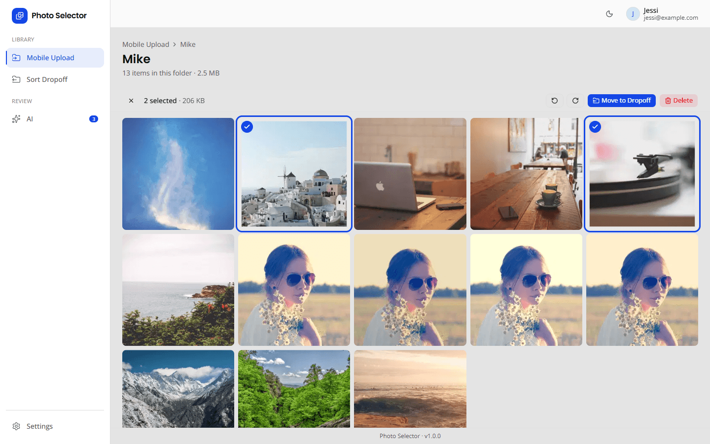
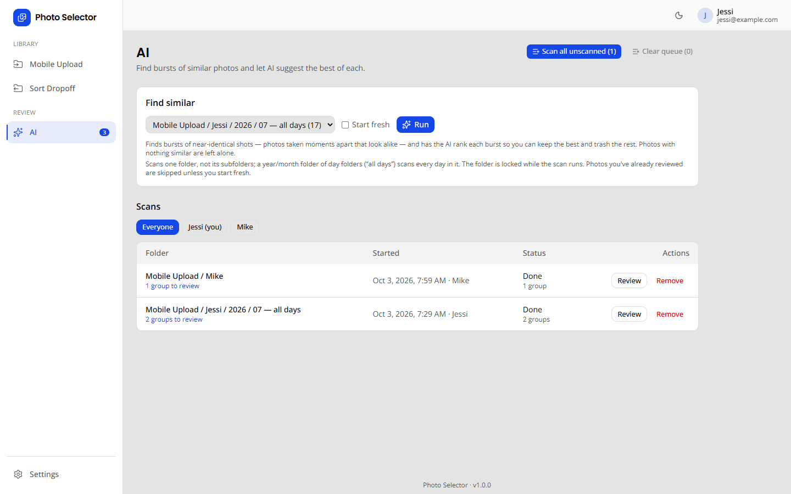
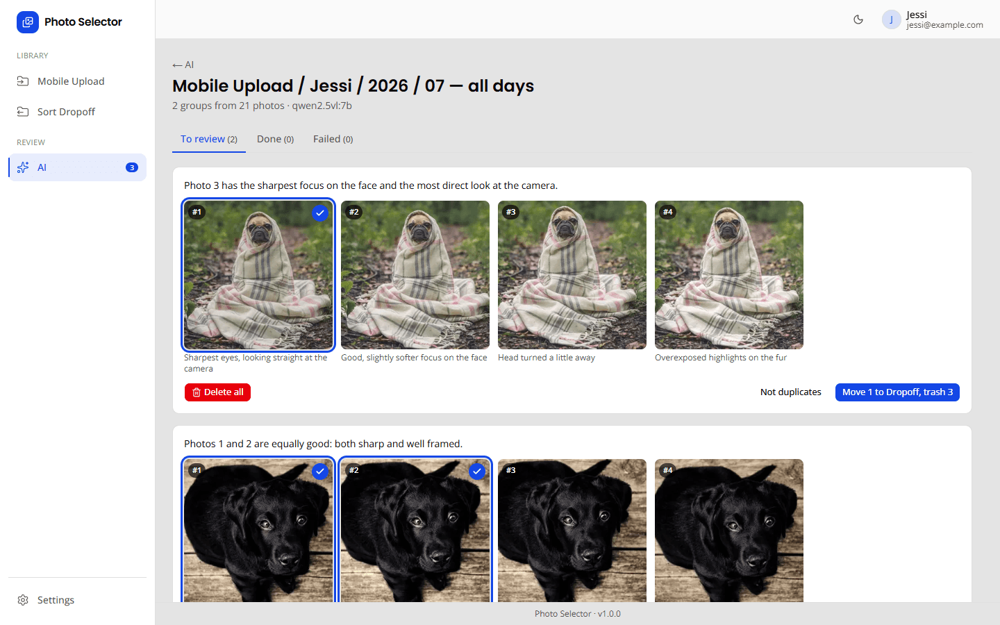
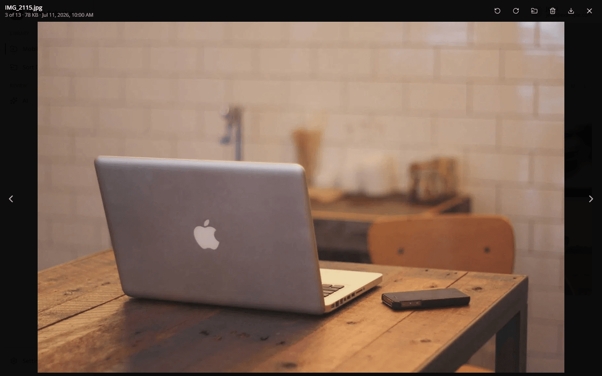
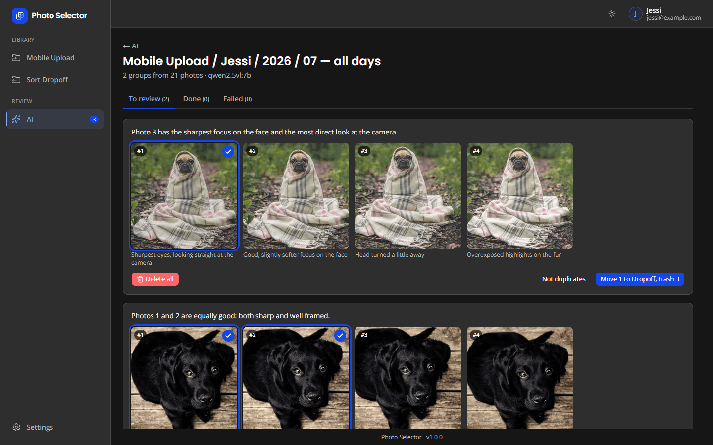

# Photo Selector

A web app for sorting phone uploads on a NAS. Browse `Mobile Upload`, keep the
photos worth keeping, delete the rest, and move the picks to `Sort Dropoff`.
It runs in a container on the NAS, next to the photos, so full-size images never
cross the network: you browse fast thumbnails from any device on the LAN.

An optional AI step finds bursts of near-identical shots and suggests the best
take of each, using any OpenAI-compatible vision model you host yourself.



## Features

**Library**
- Fast thumbnail grid for folders of any size (tested with 10,000 photos):
  only what's on screen is drawn, and thumbnails scrolled past are never made.
- Click to select, Shift-click for a range; move to Sort Dropoff, delete
  (to an in-app trash with Undo, purged after 30 days) or rotate (lossless for JPEG).
- Full-screen viewer with keyboard navigation, videos and iPhone HEIC photos.
- A background worker pre-makes thumbnails and watches for new uploads.
- **User Temp Storage**: right-click photos anywhere (library or AI results) and
  choose **Move to User Temp Storage…** to move or copy them into another
  user's staging folder with a note. Opening one there shows the note; from
  there it can be rotated, deleted, moved to Sort Dropoff or sent on to someone
  else. Sending a file that's already in that folder replaces it and updates the note.

**Video editing**
- **Tools → Video Editing**: cut video clips together on a timeline and export
  an MP4 on the server. See [Video Editing](#video-editing).

**AI review** (optional)
- Groups bursts locally, by capture time and visual similarity; nothing leaves
  the NAS except the groups sent to *your* AI server.
- The model ranks each burst: eyes open, looking at the camera, natural smile, sharp.
- Review page with the AI's picks pre-selected: **Move picks to Dropoff, trash
  the rest**, **Not duplicates**, **Delete all**, or **Accept all selections**
  for a whole page. Everything is undoable.
- Handling the last result closes the scan: it leaves the AI page and you're
  taken back to the list. Undo brings it back.
- Year/month/day upload folders (`2026/07/04`) are scanned a month at a time.
- **Scan all unscanned** queues every folder; the folder being scanned is locked
  so nothing changes under it.
- **Find Screenshots** tab: finds screenshots and saved images (memes,
  downloads, forwarded pictures) in a folder, to delete or move to Sort Dropoff
  in bulk. Photos with camera details and HEIC files skip the AI; the rest are
  sent four to a request. These scans don't lock the folder.
- **Quality Checks** tab: finds technically bad photos (motion blur, out of
  focus, closed eyes, far too dark or bright, pocket and other accidental shots,
  a finger over the lens) to delete in bulk. Every photo is sent, four to a
  request, and the AI says what's wrong with each one it flags.
  Flagged photos get a red frame in the library; right-click one for
  **See all bad images in this folder**.
- Editable AI instructions for each scan type (Settings → AI); the reply format stays fixed.

**Everything else**
- Accounts with admin and user roles, light and dark themes.
- Settings → Storage shows whether each folder is readable and writable, and
  the thumbnail worker's progress.

| AI scans | AI review |
| --- | --- |
|  |  |
| **Viewer** | **Dark theme** |
|  |  |

*Screenshots use stock photos from [Lorem Picsum](https://picsum.photos) (Unsplash licence); the AI results are sample data.*

## Install (Docker)

Images are published to GitHub Container Registry on every push to `main`
(`linux/amd64` and `linux/arm64`), tagged `latest` and `sha-<commit>`:
`ghcr.io/yatzin/photo-selector`.

### 1. Create a `docker-compose.yml`

On the NAS (or anywhere with Docker and access to the photo folders):

```yaml
services:
  photo-selector:
    image: ghcr.io/yatzin/photo-selector:latest
    container_name: photo-selector
    ports:
      - "3200:3200"
    volumes:
      # App data: database and thumbnail cache (~25 KB per photo). Not the photos.
      - /volume1/docker/photo-selector:/data
      # The two photo folders, and nothing else from the share. Left side = the
      # NAS's own path for the share folder (UGOS: folder properties, or `ls /volume1`).
      - "/volume1/Photo/Mobile Upload:/photos/upload"
      - "/volume1/Photo/Sort Dropoff:/photos/dropoff"
    environment:
      # The NAS user and group the app acts as. See "File share permissions" below.
      PUID: "1000"
      PGID: "10"

      # Signs login sessions. Generate your own: `openssl rand -base64 32`.
      # Changing it later signs everyone out.
      AUTH_SECRET: "replace-me"

      # Optional: the URL you browse to, e.g. http://192.168.1.50:3200.
      AUTH_URL: ""

      # First admin account, created only when the database is first set up.
      ADMIN_NAME: "Admin"
      ADMIN_EMAIL: "you@example.com"
      ADMIN_PASSWORD: "changeme-please"

      TZ: "America/New_York"

      # Optional: set to "off" to make thumbnails only when someone views them.
      # THUMB_WORKER: "off"
    restart: unless-stopped
    healthcheck:
      test: ["CMD", "wget", "-qO-", "http://127.0.0.1:3200/api/health"]
      interval: 30s
      timeout: 10s
      retries: 3
      start_period: 15s
```

The same file is in the repo: [`docker-compose.yml`](docker-compose.yml).

### 2. Start it

```sh
docker compose up -d
```

Open `http://<nas>:3200` and sign in with the admin account. Check
**Settings → Storage**: both folders should show a tick for *Read* and *Write*.

### 3. Update

```sh
docker compose pull && docker compose up -d
```

Each image is tagged `latest`, its version (e.g. `1.3.0`, the same version shown
at the bottom of every page) and `sha-<commit>`. To stay on a version, use
`ghcr.io/yatzin/photo-selector:1.3.0` instead of `latest`.

Database changes apply themselves on start.

### Folders

| NAS share path                  | In container       | Env override          |
| ------------------------------- | ------------------ | --------------------- |
| `\\ugreen\Photo\Mobile Upload`  | `/photos/upload`   | `PHOTOS_UPLOAD_DIR`   |
| `\\ugreen\Photo\Sort Dropoff`   | `/photos/dropoff`  | `PHOTOS_DROPOFF_DIR`  |
| (app data)                      | `/data`            | `DATABASE_URL`, `PHOTOS_CACHE_DIR` |
| (app data) User Temp Storage    | `/data/UserTempStorage` | `PHOTOS_TEMP_DIR` (created on start) |
| (app data) Video Editing Inbox  | `/data/VideoEditing/Inbox` | `PHOTOS_VIDEO_INBOX_DIR` (created on start) |
| (app data) Video Editing Projects | `/data/VideoEditing/Projects` | `PHOTOS_VIDEO_PROJECTS_DIR` (created on start) |

## Video Editing

Tools → Video Editing cuts video clips, still images and sound files together and exports an MP4.

**Getting clips in.** Right-click files in the library, use the toolbar's
**Video Editing** button, or the button in the viewer, then choose
**Move to Video Editing…**. The files go to `Inbox/<user>` with a note, and you
pick whose folder. You can copy instead of move.

**Projects.** Each one is a folder, `Projects/<user>/<project>/`:

- `project.json`: the timeline. Version 3 stores tracks (layers) and every
  clip's start. Older projects (version 2, and version 1 with one list of
  clips) open with the same timeline, their base clips end to end from 0, and
  are saved as version 3 from the next edit
- `assets/`: the clips and images the project uses
- `output/`: the latest export, and `.export-state.json`, which records what it
  was made from
- `config/export.json`: export size and frame rate

The Inbox list in the editor shows a thumbnail for each video and image. Its
files are drag-only: dragging one onto the timeline copies it into `assets/`
(Project media) and adds it where you drop it. The original stays in the Inbox.
Dragging the same Inbox file again reuses the copy already in the project
instead of copying it twice. Reuse goes by path: a file replaced in the Inbox
under the same name reuses the existing copy (delete that copy from Project
media to import the new one).

**Importing from your computer.** **Import** in the editor's top bar, right
after the back arrow, the project name and the saved status (Export stays at
the far right), opens the file
picker: choose any number of videos, images and sound files. You can also drop
files from your computer onto Project media. They upload straight into the
project's `assets/` (not through the Inbox), two at a time, each listed under
the Import button with its progress and a cancel button; each one appears in
Project media as soon as it's in. A file that fails says why, with Retry and
Dismiss, and the others carry on. The name is kept (cleaned of path parts and
characters the disk can't take; a taken name gets " (1)", as Inbox copies do).
- Formats: images and videos as the Inbox takes them (jpg, png, gif, bmp,
  webp, heic, tif, dng; mp4, mov, m4v, avi, wmv, mkv, flv, 3gp, webm) and
  sound files (mp3, wav, m4a, aac, ogg, opus, flac, wma). What a file is comes
  from ffmpeg reading it, not its name: a renamed text file is refused, and a
  video file with only sound counts as a sound file.
- Up to 4 GB a file; empty files are refused. The browser sends a file in
  32 MB pieces, one request each, onto a hidden part file in the project
  folder (`.import-<id>.<ext>`, removed when the upload is cancelled or fails,
  and any left over a day later), then it's renamed into `assets/`. Nothing
  needs configuring: the upload route is left out of `proxy.ts` (which would
  otherwise buffer request bodies in memory) and no request runs near Node's
  5 minute request timeout, in `npm run dev` and in the Docker image alike.
- WMA and some other formats may not play in the browser preview; they still
  export.

**Deleting media.** Right-click an item in Project media and choose Delete
(or focus it and press **Delete**). The warning says how many timeline clips
use it. Confirmed, it leaves the project: every clip of it comes off the
timeline (leaving gaps), its copy in `assets/` is deleted and undo history
starts over. The Inbox original isn't touched, so you can import it again.
Not while the project is exporting, or while that file is being imported.

**Editing.**
- Drag a clip or image onto the timeline.
- An image starts as a 5 s clip. Drag either edge to stretch or shorten it,
  from 0.2 s up to 10 minutes. It exports letterboxed with silence.
- Drag a clip's edges to trim it, or drag the clip along its track to move it.
- **Layers.** The timeline has up to four tracks, numbered 1 to 4 in the
  timeline's left column: 1 at the bottom is the base, 2 to 4 above it are
  layers. The preview shows every layer with a
  clip at the playhead, the higher ones on top, and every layer's sound is
  mixed. A clip you haven't moved, scaled or cropped fills the frame
  (letterboxed in black) and covers the layers below.
  Drop media onto a layer's row to put it there, or onto the dashed row above
  the top layer (it shows while you drag) to make a new layer. The **+** at
  the left of the ruler adds an empty layer; an empty layer has an **×** to
  remove it. Drag a clip up or down to move it to another layer.
- **Drop on the player.** Drop a Project media or Inbox file on the preview
  to add it at the playhead, on the lowest layer free for its whole length
  there (a new layer when none is, up to four). It comes in selected, with
  its frame showing, ready to move or resize.
- **Many layers.** With three or four layers the rows are half height. A
  slim slider at the timeline's right edge makes them taller or shorter
  (0.6x to 2x; double-click it to reset), remembered in this browser; the
  timeline scrolls up and down when they don't fit.
- **Mouse wheel.** Over the layer numbers it makes the rows taller (up) or
  shorter (down), with any number of layers, in step with the slider. Over the
  ruler it zooms time in (up) or out (down) around the pointer, in step with
  the Zoom slider; **Ctrl/Cmd** + wheel does the same over the clips. Over the
  clips the wheel scrolls the timeline sideways (a trackpad's sideways swipe
  too), and **Shift** + wheel scrolls up and down when the layers don't fit.
- **Timeline length.** The timeline is as long as its content plus a little
  room, never narrower than the view. Dragging a clip, an edge or a file
  towards the end makes it longer as you go, and dragging near the left or
  right edge of the view scrolls it. When the last clip goes (deleted, moved
  or trimmed), the timeline shrinks back.
- **Free placement.** On every track, the base (layer 1) included, clips stay where
  you put them and gaps are fine: removing, trimming or moving a clip leaves
  the rest where they are. A gap shows black and is silent, in the preview
  and the export. Dragging a clip sideways moves it freely. Clips on one track never
  overlap: a clip dropped on another slides to the free space after it.
  Trimming a clip's left edge keeps the picture where it was.
- **Snapping on the timeline.** A clip you drag, the edge you trim and the
  ghost of a file you drop snap to the playhead, the start and the edges of
  the clips on every layer, within 8 px. A thin pink line shows the point it
  snapped to. While you drag, a hint at the top of the timeline says to hold
  **Alt** to stop snapping, and changes to "Snapping off" while you do.
- **Snap (layer 1).** The magnet box beside layer 1's number, off by
  default, snaps the base layer's clips together: ticking it closes every gap
  on layer 1 (one undo step), and while it's on layer 1 stays end to end. A
  clip dropped or dragged onto layer 1 goes in between two clips (a line shows
  where; no snapping or Alt hint there), trimming ripples the clips after it, and deleting or moving a clip
  away closes its gap. Dragging a clip's left edge shows the plain trim while
  you drag (the edge follows the pointer and nothing else moves, even over the
  clip before it; it doesn't snap to other layers and shows no Alt hint); when
  you let go the layer closes up again. The right edge
  ripples the clips after it as you drag. Unticking it frees layer 1 again;
  clips stay where they are. Layers above it are always free.
- **Move, resize and crop on screen.** Click a clip in the preview to select
  it (the topmost one under the pointer; empty canvas deselects). The
  timeline highlights the same clip. Drag it to move it. Drag a corner to
  enlarge or shrink it with its shape kept; the opposite corner stays put.
  Drag the top, bottom, left or right handle to crop the picture from that
  edge (drag back out to undo the crop); on a very small frame the middle
  handles hide so the corners stay usable. While you drag, the picture's
  edges and centre (or the cropped edge) snap to the frame's vertical and
  horizontal centre lines and its edges, and a thin line shows each one.
  A hint below the preview says to hold **Alt** to stop snapping, and
  changes to "Snapping off" while you do. **Esc** during a drag cancels it,
  and each drag is one undo step. The area around the frame is light gray.
  Once a clip is moved, shrunk or cropped, the layers below show around it,
  and black where nothing covers (the base layer too). With a clip selected
  in the preview, the arrow keys nudge it by 1% (**Shift**: 5%); a focused
  handle takes the arrow keys to resize or crop. **Reset** in the toolbar
  puts the selected clip back to fill the frame, unturned and unflipped.
  Images and videos work the same, and the export matches the preview.
- **Rotate and flip.** A selected clip's frame has a white round button at
  its top right: drag it round to turn the clip about its centre (it snaps to
  every 15 degrees unless you hold **Alt**, and shows the angle while you
  drag). Double-click it to straighten the clip; focused, the left and right
  arrows turn it by 1 degree (**Shift**: 15). Of the two buttons at the top
  left, the left one flips the picture top to bottom and the right one left to
  right, where it is. The frame and
  its handles turn with the clip, and moving, resizing and cropping work along
  the clip's own sides. A turned clip's move snaps its outline's box; its
  resize and crop don't snap. Each turn or flip is one undo step.
- **Mute a clip.** A video clip with sound has a small speaker button at its
  top right (it shows on hover and on the selected clip, and stays while the
  clip is muted). It mutes that clip alone in the preview and the export; a
  split keeps the mute on both halves. **M** mutes or unmutes the selected
  clip. Layers have no mute of their own: a project saved with a muted layer
  opens with each of that layer's clips muted.
- **Sound files and the audio layer.** Sound files sit in Project media with
  a music note and their length. Their clips live on the audio layer, row
  **0** below layer 1 (it shows once it has a clip, and while a sound file is
  dragged in), and only there: a sound file dropped anywhere on the timeline
  (or on the preview, at the playhead) lands on it at that time, an audio
  clip dragged towards another layer stays on it and only moves in time, and
  a video, image or text clip dropped or dragged onto it is refused (a red
  ghost, "Only sound files go on the audio layer."). It isn't one of the four
  layers and has no Snap box. Clips there don't overlap (one slides clear, as
  on the other layers) and snap to every layer's clip edges. Each is teal with
  its name, length, waveform (the waveform button applies) and mute button;
  the menu has Split, Delete, Mute and Edit length (up to the rest of the
  file). Audio clips have audio transitions between them and audio fades at
  their free ends (see Audio transitions and In and out transitions), but no
  audio overlaps, picture or Reset.
  They play in the preview with the picture and mix into the export like a
  video clip's sound (a muted one is silent); where only audio plays the
  picture is black.
- **Waveforms.** Each video clip with sound shows its sound as a waveform
  over its thumbnail, for the part of the file the clip plays, so it follows
  zoom and trims. The waveform button in the toolbar hides or shows them
  (remembered in this browser). The server reads a file's sound once, on the
  first request, and keeps the result next to it in `assets/` as
  `.<file>.peaks`; deleting the media item deletes it too.
- The toolbar above the timeline shows the time, then Undo, Redo, Split and
  Delete (each button's tooltip names its shortcut), Add text, two transition
  buttons while a clip is selected (**Transition before** / **after** where a
  clip touches that side, **Transition in** / **out** where none does), and Reset when the
  selected clip is moved, scaled, cropped, turned or flipped; Play/Pause in
  the middle; the waveform button and the zoom slider at the right.
- In the dark theme the editor's accent (playhead, selection, trim handles,
  the Snap box, drop markers) is a light sky blue so it stands out.
- **Text.** **Add text** in the toolbar puts a 5 s "Text" clip at the
  playhead, white and centred, selects it and opens **Edit text**: the text
  (Enter starts a new line; nothing wraps), its colour, its direction and its
  font. It
  goes on the selected clip's layer; with nothing selected (or a clip on a
  snapped layer 1) on the lowest layer above the base that's free there, or a
  new layer. Double-click a text clip on the timeline or the preview, or
  right-click it and choose Edit text..., to change it. A text clip works like
  an image: trim or stretch it, Edit length, split it, move it between layers,
  and move, resize (the corner handles are its size), crop, turn and flip it
  in the preview. Its menu also has **Horizontal** and **Vertical** (one
  letter a line, stacked; a space leaves a gap), with a check on the current
  one. On the timeline it's a violet block showing its text.
- **Fonts.** Edit text has 50 fonts, each name drawn in its own font with a
  word on its look. A row of mood chips filters them: Clean, Bold, Happy, Fun,
  Elegant, Handwritten, Retro, Tech, Scary and Creepy (All shows every font).
  Elegant holds Playfair Display and seven sweeping scripts: Great Vibes,
  Dancing Script, Parisienne, Tangerine, Monsieur La Doulaise, Sacramento and
  Alex Brush. Click a font, or move with the arrow keys, Home and End, or
  type the first letters of its name; the sample above shows your text in it.
  Mono stays the default and the font older text keeps. Bangers, Creepster,
  Nosifer, Bungee, Graduate, Luckiest Guy, Eater and Butcherman show lower
  case as capitals. The fonts are bundled with the app (`public/fonts`, about
  5 MB, each licence beside it and all listed in
  `public/fonts/THIRD_PARTY_FONTS.md`: SIL Open Font License 1.1, or Apache
  2.0 for Permanent Marker, Special Elite, Luckiest Guy, Chewy and Ultra). The
  editor only downloads a font when a text clip uses it or it scrolls into
  view in the list. The export draws the text where the preview does: the box
  comes from each font's stored letter widths, the same numbers on both
  sides, with room for script swashes. Letters a font lacks (emoji, some
  scripts, Orbitron's ^) come from a fallback font and may differ.
- **Colours.** Under Colour, Edit text shows a round swatch for each colour
  the project's other text clips use (most used first, up to 12); click one
  to use it. The font sample sits on a dark or light backdrop, whichever
  shows the chosen colour better.
- **Text animation.** The Animation tab of Edit text (or **Animation...** in
  a text clip's menu) sets an **In** animation, played from the clip's start,
  and an **Out** one, played up to its end, each with its own type and length
  in seconds. Types: Fade; Slide from (In) or to (Out) the left, right, top or
  bottom, the whole text travelling in from beyond that edge of the frame;
  Sweep from or to a side, a wipe inside the text's own box that never leaves
  it; Explode (In lands from twice the size as it fades in, Out bursts to
  twice the size as it fades); Implode (Out shrinks to nothing, In grows from
  a point); Pop (scales up with a small overshoot); Spin (a full turn as it
  grows or shrinks); Bounce (drops in from above with bounces, Out falls off
  the bottom); Typewriter (letters appear one by one, top to bottom for
  vertical text; Out takes them away from the end). In eases out, Out eases
  in. In and Out together can't run longer than the clip: Apply shortens both
  in proportion (the dialog says to what), and trimming the clip shorter does
  the same. Splitting a text keeps the In on the first piece and the Out on
  the second. Animations play on top of the text's position, size, turn,
  flip and crop; the selection handles stay where the text rests. A ramp at
  each end of the timeline block shows how long each runs. Apply is one undo
  step with the rest of the dialog.
- **Transitions.** Two clips on the same layer that touch (one ends where
  the next starts) can blend into each other. Select a clip: a white circle
  with the transition icon sits on its top edge at each side where another
  clip touches it, and the toolbar shows **Transition before** and
  **after** (on a side with no clip touching, **Transition in** or **out**
  instead; see below). Either opens the **Transition** box ("Between a.mp4
  and b.mp4"): the two clips, a grid of
  transitions, each playing a small sample (Fade: Crossfade, Fade through
  black, Fade through white; Wipe left, right, up and down; Slide left, right,
  up and down; Shape: Circle open, Circle close, Radial; Effect: Pixelate,
  Dissolve, Zoom in, Blur; Creative: Collage, Exchange, Page turn, Reveal,
  Heart; Glitch and whip: Glitch, Glitch reveal, Whip left, right, up and
  down), **None** to take it off, and the duration in seconds. Beside the
  grid (below it on a narrow window) a loop plays the two real clips across
  the cut with the chosen transition and duration, and their sound (mixed as
  the export mixes it; the speaker button mutes it), from up to 2 s before it
  to up to 2 s after, with a play/pause button and a bar marking where the
  transition sits; under it, what the transition does,
  what it's best for and when to avoid it. With reduced motion the loop
  starts paused on the cut. Below them is the **Audio overlap** (see J-cuts
  and L-cuts). Apply (or Remove) is one undo step for both; the arrow keys
  move through the grid and Esc cancels. The player pauses while the box is
  open. As in Premiere and DaVinci Resolve, the transition is centred on
  the cut: clips keep their places and the timeline its length, and over the
  duration the first clip plays half of it past its end and the second half
  of it before its start, using the footage beyond the trimmed range. A clip
  without that much footage is trimmed automatically: the first clip's end
  moves earlier, or the second clip's start later, by what's missing, and
  every later clip on that layer moves back by the trims so the two still
  touch (other layers stay put). The box says what Apply will trim ("Applying
  trims 0.4 s from the end of a.mp4 and 0.3 s from the start of b.mp4; later
  clips on this layer move 0.7 s earlier."), and Apply and its trims are one
  undo step. A shorter transition later doesn't give the trims back. The
  longest a transition can be is 10 s, as long as each clip, after its trim,
  still holds its half beside its other cut and stays at least 0.2 s long;
  the box shows it ("Longest possible: 3.2 s (the second clip is only 1.6 s
  long)"). Images and text have footage enough and are never trimmed. On the
  timeline a transition is an amber block
  across the cut, half over each clip; click it to change it. The sound
  crossfades over the same time (equal power). The preview draws pixelate and
  blur as a blurred crossfade and dissolve as a plain crossfade; the export
  draws each exactly. The Creative and Glitch and whip transitions are the
  app's own: Collage breaks the first clip into squares that shrink and swipe
  away one after another; Exchange shrinks it to a card that swaps with the
  next clip's card, which then grows; Page turn folds it away from the right
  edge, the page's plain back and a soft shadow showing; Reveal splits it
  down the middle and slides the halves apart; Heart opens the next clip in a
  growing heart; Glitch splits the colours, shifts strips and flashes noise
  blocks, switching clips at the peak; Glitch reveal swaps the picture strip
  by strip with jittering split colours; a Whip moves both clips together
  fast, with motion blur at the peak. The preview and the export follow the
  same motion; the page fold is straight, and the whip's blur and the glitch's
  colour split can look a little different in the preview.
- **J-cuts and L-cuts.** In the same box, **Audio overlap** lets the sound
  run across the cut while the picture cuts where it did: a **J-cut** starts
  the next clip's sound early (you hear the next scene while still seeing
  this one), an **L-cut** keeps the previous clip's sound going over the next
  picture. Pick None, J-cut or L-cut and the overlap in seconds. A J-cut needs
  the next clip to be a video with sound, an L-cut the previous clip; a clip
  without the footage before its start (J) or after its end (L) is trimmed
  for it as for a transition, and the box says so. Either is at most 10 s and
  as long as the clip it plays over, beside its other cut; with no sound the
  option is greyed out with the reason. A muted clip keeps the setting
  but stays silent. Through the overlap both sounds play mixed at full volume
  (no ducking), with a 0.15 s linear fade at the new edge so it never clicks.
  With a transition on the same cut the pictures still blend, but the sound
  follows the J or L instead of crossfading. On the timeline an overlap is a
  thin teal band along the bottom of the clip it plays over, beside the cut
  ("J-cut 1 s" on hover), and the cut's circle shows as set. The loop in the
  box plays the overlap's sound and marks it on its bar, labelled under it
  ("Audio starts early (J-cut, 1 s)").
- **Audio transitions.** Two audio clips that touch on the audio layer get
  the same circles, toolbar buttons, amber block and **Transition** box, with
  sound transitions instead of pictures: **Crossfade curves** (Linear, Equal
  power, the default, S-curve, Logarithmic, Exponential, Dip to silence) and
  **Creative** (Low-pass sweep: the outgoing sound muffles away as it fades;
  Tape stop: it slows down and drops in pitch to a stop; Echo out: it trails
  off into echoes; Telephone swap: it narrows to a phone-like band as it
  fades and the next sound starts in that band before opening up). Each tile
  draws the two sounds' levels across the transition. The rules are a picture
  cut's: centred on the cut, trimmed automatically for a clip without the
  sound beyond it (later clips on the audio layer move back), at most 10 s,
  one undo step, and the clips are linked (locked, Unlink, Move group along
  the audio layer only). There is no audio overlap there. The box's loop
  plays the two real sounds across the cut, shaped as the export shapes them,
  over a bar with the transition's band and each sound's level; the editor's
  preview plays them the same way (the creative ones through the browser's
  audio filters, a feedback echo and a slowed-down player for the tape).
- **In and out transitions.** A clip's end with no clip touching it can come
  in from nothing or go out to nothing (the layers below, or black; silence
  for sound). Select the clip: a white circle sits just inside each free end
  (the toolbar's **Transition in** and **Transition out** do the same), and
  opens the **Transition** box for it ("In: start of a.mp4", "Out: end of
  a.mp4"). A video or image offers the picture transitions worked on its own
  transparency, its loop playing the clip over a checkerboard with 2 s of
  nothing before an in or after an out: every type at an out end but the dips
  to black and white (meaningless against nothing); at an in end also not
  Zoom in (it only zooms the outgoing picture) and Collage (its squares are
  the outgoing picture's). A video with sound fades its own sound with the
  picture (equal power). An audio clip offers sound fades: the five curves,
  a low-pass sweep (opening as it fades in, muffling as it fades out), a tape
  start or stop, and an echo tail (out only), with the sound loop. A text
  clip's circles and buttons open its Edit text box on the Animation tab
  instead (its In and Out animations already do this; Animation... in its
  menu too). The transition runs inside the clip (its first or last seconds,
  0.1 to 10 s, in and out together no longer than the clip), so nothing is
  trimmed or moved, and it doesn't link the clip to anything. On the timeline
  it's an amber ramp at that end, as long as it runs ("Wipe left in 1.5 s" on
  hover); on an audio clip a line draws the fade's level over the waveform.
  Trimming, splitting (the first piece keeps the in, the second the out) and
  Edit length shrink both in proportion, as a text's animations do. A clip
  that comes to touch that end (a move, a trim, a drop) takes it away, with
  the notice "Edge transition removed: the clip now has a neighbour"; undo
  brings it back.
- **Audio levels.** Right-click a clip with sound (an audio clip, or a video
  whose file has sound) and pick **Edit Audio Levels...** (after Mute; a dot
  beside it when the clip has levels set). **Volume** turns the whole clip
  down or up, -60 to +24 dB in 0.5 dB steps (slider or the dB box;
  double-click the slider or press Reset for 0 dB). **Filters** add up to
  four effects, run in the order listed: click a chip to add or remove one
  (the box under the chips says what the one you point at does, what it's
  best for and when to avoid it; a fifth gets a note to remove one first),
  then reorder with the arrows, set the intensity slider where there is one,
  or take one off with X. Presets set the list in one click: Voice clean-up
  (Low cut, Compressor, Voice boost, Normalize), Radio (Old-time radio),
  Phone (Telephone) and Muffled hallway (Muffled, Room reverb). The groups:
  Clean-up and tone (Low cut, High cut, Bass boost, Treble boost, Voice
  boost, Tame harshness, Compressor, Limiter, Noise gate, Noise reduction,
  Normalize to -16 LUFS, Stereo to mono, Wide stereo), Space (Room reverb,
  Hall reverb, Echo, Slapback), Character (Lo-fi, Telephone, Old-time radio,
  Through a can, Megaphone, Muffled, Underwater) and Creative (Robot,
  Chipmunk, Deep voice, Alien, Vinyl crackle). **Preview** plays the clip's
  sound through them, about 6 s from its start (or from the playhead when
  it's inside the clip), looping and following the controls as you move
  them; the editor's player is paused while the box is open. Apply is one
  undo step, Cancel or Esc discards, Remove all takes the levels off. The
  editor's preview plays clips with levels the same way, with their fades
  and transitions on top; a muted clip stays silent. On the timeline such a
  clip shows a small sliders mark ("Audio: +3 dB, Telephone" on hover) and
  its waveform grows or shrinks with the volume (red where a boost would
  clip). Splitting keeps the levels on both pieces; moving, Edit length,
  undo and redo keep them too.
- **Linked clips.** Clips joined by transitions or audio overlaps (a group)
  are locked in place. As soon as you start dragging one, a red X covers it,
  the clip stays where it is, and a notice offers **Unlink this clip** (takes
  the transitions and audio overlaps off both of its sides) and **Move group
  (N)**. Move group unlocks that group only: drag any of its clips and they
  all move together, along their layer or onto another one, snapping as one
  block (one undo step per drag). The group lands whole, its clips still
  end to end, so its transitions and audio overlaps stay. On a free layer it
  slides clear of the clips there as one block; on a snapped layer 1 it goes
  in at the slot under the pointer (not between two linked clips), and a
  snapped layer 1 it leaves closes up behind it. The add-a-layer row makes a
  new layer for it (up to four); the audio layer refuses it (a group of audio
  clips moves along the audio layer only). The first drag
  starts a 5 minute window, shown as a countdown on the group's first clip
  (amber in the last 30 seconds; it slides to the clip's bottom left while
  you point at the clip, so the mute button stays free), in which you can
  move it as often as you like. When the time runs out the group
  locks again (a drag in progress springs back), and a drag then shows the
  red X across every clip of the group. Opening the Transition dialog for a
  cut inside the group locks it at once. An unlock you don't use lapses when
  you select a clip outside the group, make another edit, or after 5
  minutes. Nothing about this is saved: reloading locks every group. Trimming
  the edge at a transition is refused the same way (Unlink only), except on a
  snapped layer 1, where the clips stay together; trimming the other edge
  keeps the transition, shortened if it no longer fits. A file dropped
  between two linked clips on a snapped layer 1 is refused. Splitting a clip
  keeps its transitions on the outer sides, deleting it takes them away, and
  Edit length refuses a change that would part linked clips (with an Unlink
  button). Audio overlaps follow the same rules, and a trim that leaves one
  too little footage shortens it or takes it off with a notice. The notice
  stays while you point at it.
- **Right-click a clip** for its menu: Split at playhead (when the playhead
  is inside that clip), Delete, Mute or Unmute and Edit Audio Levels... (a
  clip with sound), Edit length... and, for a text, Edit text..., Animation...
  and Horizontal / Vertical. The arrow keys, Home and End move through it,
  Enter runs an item and Esc closes it. The menu shows each item's shortcut.
- **Edit length** opens a box with Start, End and Length in seconds.
  Changing Length keeps Start and moves End; changing End changes Length;
  changing Start moves the clip and keeps its length. "When it overlaps other
  media" picks what happens on the same layer: **Push later media** (the
  default) moves the clips after it right just enough, keeping their gaps;
  **Overwrite media** cuts into the clips it covers (trims them, splits one it
  sits inside, removes one it covers whole). Other layers never change. On a
  snapped layer 1 the start is fixed and the clips after it follow the new
  length. Apply is one undo step.
- For a clip with sound (an audio clip, or a video whose file has sound) the
  box also has **Source**: the whole file's waveform with the part the clip
  plays framed and the rest dimmed. Drag the left or right handle to crop the
  start or end, or drag the framed part to slide it along the file (same
  length). Edges snap to the tick marks and the file's ends; hold Alt to turn
  that off. The handles and the frame also take the arrow keys (0.01 s, 0.1 s
  with Shift), Home and End; double-click the strip for the whole file.
  Cropping changes Length and End but not Start (the clip stays where it is on
  the timeline), sliding changes only which part plays, and typing a Length
  moves the right handle. Apply sets the source and the timing together in one
  undo step. Without peaks the strip says "Waveform unavailable" and the rest
  still works; it shows even with the timeline's waveforms off.
- **S** or Split cuts the selected clip at the playhead (or the top clip
  there), **Delete** removes the selected clip, **M** mutes or unmutes it,
  **Esc** deselects, **Space** plays.
- Undo and redo (toolbar, **Ctrl/Cmd+Z**, **Ctrl/Cmd+Shift+Z** or **Ctrl+Y**)
  cover the last 50 timeline edits. Imports aren't undone: an undone clip's
  file stays in Project media.
- Drag the bar between the preview and the timeline to resize the preview
  (or focus it and use the arrow keys). Double-click it to reset. The size is
  remembered in this browser.
- The project saves itself after 1.5 s without changes (at least every 5 s
  while you keep editing), and before an export.
- The main navigation collapses to icons with the button at its bottom; the
  choice is remembered in this browser.

**Export.** Renders an MP4 into `output/` on the server with ffmpeg, at
1920x1080 and 30 fps, then your browser downloads it. `output/` keeps one
copy: a finished export deletes the files there before it (subfolders are left
alone). A failed export leaves the previous copy. Exporting again
with no changes since (renaming the project or importing an unused file
doesn't count) skips the render and downloads the copy already there.
Each text clip is drawn into a transparent PNG first (ffmpeg's drawtext with
the clip's bundled font file from `public/fonts`), in a temporary folder
removed with the export, and placed like an image. Its animations are drawn
by ffmpeg from the same maths the preview uses, frame by frame; a typewriter
on a text of more than 100 characters reveals it in 100 equal steps of a few
characters each, in the preview too.
Transitions use ffmpeg's xfade: each clip of a chain joined by transitions is
played half a transition past its cut, put on a transparent frame of its own,
and joined to the next at the start of their transition. The app's own
transitions use xfade's custom expression, worked out per pixel on RGB
frames, with the motion for each frame of the transition worked out in
advance from the same functions the preview uses; whips add ffmpeg's gblur
in three steps. They cost more than the built-in ones: a 2 s one at 1080p
takes roughly 15 to 35 s to export on a 12-thread machine (a whole 1080p
video exports in about real time otherwise).
A J-cut or L-cut only moves sound: the next clip's sound is read from its
overlap before its in point and delayed to start that much earlier, or the
previous clip's is read on past its out point, each with a short fade at the
new edge, and mixed with the rest.
Audio transitions shape the two sounds with ffmpeg's afade curves (tri, qsin,
hsin, log and exp for the five curves; Dip to silence fades out over the
first 40% and in over the last 40%) and, for the creative ones, filters on
the outgoing sound's last stretch: a low-pass sweep in eight steps from 12
kHz down to 300 Hz, the 300 Hz to 3.4 kHz telephone band (on the incoming
sound too for its first three quarters), a tape stop as eight ever slower
stretches of the source (half the transition's worth, played over all of
it, pitch dropping with the speed), and an echo trail (aecho at 200, 400 and
600 ms) after the dry sound ends at the cut. An in or out transition xfades
the clip with a copy of itself made transparent (its alpha set to 0), so the
effect uncovers or covers whatever is below; an audio clip's edge is an afade
curve, a low-pass sweep, a tape start or stop, or an echo tail inside the
clip.
Audio levels go on each clip's sound right after it's cut from the file:
`volume=<gain>dB`, then each effect's filters in order (highpass, lowpass,
bandpass, equalizer, bass and treble shelves, acompressor, alimiter, agate,
afftdn, loudnorm, pan, adelay, aecho taps for the reverbs and echoes, aeval
for clipping, bit reduction, ring modulation and the fixed-seed hiss and
crackle, vibrato, flanger, asetrate with atempo for the pitch shifts), cut
back to the clip's length, then its fades, J- or L-cut and transitions as
before. Projects without levels export exactly as they did.

**Limits in this version**
- Audio levels are one setting for the whole clip (no volume curve over
  time). Text has no size box
 (use the corner handles) and no
  outline or shadow.
- Transitions and audio overlaps only between clips that touch on one
  layer; a clip short of footage is trimmed for them (no "hold the last
  frame" fallback). The overlap's sound isn't ducked under the other clip's.
- Preview and export of audio transitions match in shape, not sample for
  sample: the preview's low-pass sweep and tape speed glide where the export
  steps (eight steps each), its echo is one feedback delay where the export
  has three taps, and a browser plays a tape no slower than 1/16 speed. A
  dissolve or pixelate at an in or out end previews as a fade or a blur, as
  at a cut.
- Audio levels: the preview builds the same filter chain from the same
  numbers, but five effects are heard in the export only (Noise gate, Noise
  reduction, Normalize, Chipmunk, Deep voice: the browser has no gate,
  denoiser or loudness meter, and can't shift pitch and keep time); the box
  marks them with * and says "Not previewed" while they're applied, and the
  preview plays those dry. The compressor and limiter, the vibrato and
  flanger sweeps and the hiss and crackle (different random numbers) sound
  close to the export rather than identical. A reverb's or echo's tail is
  cut at the clip's end.
- Preview plays the files in your browser. A clip the browser can't decode
  (some iPhone HEVC) shows a message in the preview but still exports.

**Requirements.** ffmpeg 7 or newer on the server, with drawtext (libfreetype)
for text clips (the Docker image has both).
Set the folders with `PHOTOS_VIDEO_INBOX_DIR` and `PHOTOS_VIDEO_PROJECTS_DIR`.
They default to `/data/VideoEditing/Inbox` and `/data/VideoEditing/Projects`,
beside the cache.

## File share permissions

The app runs as the user and group in `PUID` / `PGID`, so files it moves keep
normal ownership on the share. That user needs:

| Folder | Access | Why |
| --- | --- | --- |
| Mobile Upload (`/photos/upload`) | **read + write**, including subfolders | Lists photos, moves picks out, moves deleted photos into its trash folder, writes rotations |
| Sort Dropoff (`/photos/dropoff`) | **read + write** | Receives the photos you keep; deleting and rotating work there too |
| App data (`/data`) | read + write | Database, thumbnail cache and User Temp Storage. The container makes it owned by `PUID:PGID` on start |

Deleted photos go to a hidden `.photo-selector-trash` folder inside each photo
folder, so Undo can put them back. It's emptied after 30 days. Both photo
folders should be on the same volume so moves are instant. Across volumes, the
app copies, verifies and then deletes, which is slower but safe.

**Choosing PUID and PGID**

1. Pick a NAS account that can open both folders over the network
   (e.g. the account you use for `\\ugreen\Photo`).
2. Over SSH, run `id <that-user>`:
   ```
   uid=1000(nasuser) gid=10(admin) groups=10(admin),100(users),1000(standard)
   ```
   `PUID` is the `uid`.
3. For `PGID`, pick the group the share is actually open to. The app gets only
   this one group, not all of the user's groups. On UGOS, shared folders are
   usually controlled by an access list that admits `admin` (10), not `users`
   (100), even though plain `ls -l` shows the folder as open to everyone.

**Checking access**

Settings → Storage and `http://<nas>:3200/api/health` report whether each
folder can be read and written. If the library says *"Mobile Upload isn't
available"*, the user/group can't open the folder. To test candidate groups
from the NAS:

```sh
sudo docker exec photo-selector sh -c 'for g in 10 100 1000; do printf "gid %s: " $g; gosu 1000:$g ls /photos/upload >/dev/null 2>&1 && echo OK || echo denied; done'
```

Use a group that says `OK`, update `PGID`, and run `docker compose up -d`.

## AI setup

Settings → AI (admins). Any OpenAI-compatible server with a vision model works,
for example:

- **Ollama** on a PC with a GPU: `ollama pull qwen2.5vl:7b`, base URL
  `http://<pc>:11434/v1`. Start Ollama with `OLLAMA_HOST=0.0.0.0` so the NAS can reach it.
- **llama.cpp / LM Studio** serving a vision model, or a hosted API with a key.

**Test connection** sends a small red image and checks the model can see it.
Each group is sent as one request with every photo in it (resized to
"Image size sent", 768 px by default). Bursts larger than "Largest group" are
split. Find Screenshots and Quality Checks send four images per request. If the server sits behind a proxy, make sure its read timeout is longer
than a group takes. Eight photos can take 80–90 seconds on a mid-size local model.

## Local development

```sh
cp .env.example .env      # set AUTH_SECRET; photo folders default to ./dev-photos
npm install
npm run dev               # http://localhost:3200 (applies migrations and seeds the admin first)
npm test                  # unit and integration tests
```

`PHOTOS_UPLOAD_DIR` can point straight at `\\ugreen\Photo\Mobile Upload` to try
the app against real photos.

Built with Next.js 16, React 19, Auth.js, Prisma + SQLite, sharp, Tailwind and
shadcn/ui. The account, theme and settings shell is adapted from HomeCenter.

## License

[MIT](LICENSE)
